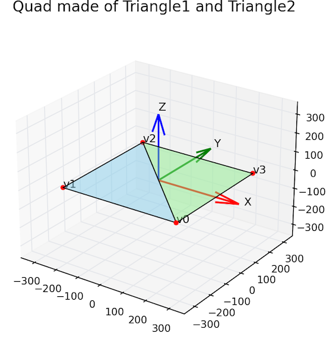

## Fundamentals

### Data structure

#### Vertex

A vertex is a data structure that represents a single point in a geometric shape used by the GPU during rendering. In graphics programming (Metal, OpenGL, DirectX, Vulkan), all shapes—triangles, quads, meshes—are built from multiple vertices. Each vertex carries the information the GPU needs to transform, shade, and rasterize that point.

This is the minimum definition of vertex.

@code_begin@
struct Vertex {
        // the position member represents the location of that vertex in space
        float2 position;
        
        // The texture coordinate refers to the coordinates used to map a texture image onto a vertex.
        float2 texCoord;
};
@code_end@

The texture coodinate is typically a float2 value:
* u : horizontal texture coordinate
* v : vertical texture coordinate

In 3D graphics, U and V are coordinates used to locate a point on a texture image, just as X, Y, Z locate a point in 3D space.
Both values are usually in the range 0.0 to 1.0, representing normalized positions inside the texture.

Following data is presented by vertices
* A triangle is defined by three vertices.
* A quad is defined by six vertices (two triangles).
* A 3D model may contain thousands or millions of vertices.

#### Quad Vertex

Following code defines a constant array of vertices that
represents a rectangular quad made from two triangles. 
This pattern is very common in Metal, OpenGL, and Direct3D rendering.

@code_begin@
        {
            // Pixel positions, Texture coordinates
            { {  250,  -250 },  { 1.f, 1.f } },         // triangle-1 (v0)
            { { -250,  -250 },  { 0.f, 1.f } },         // triangle-1 (v1)
            { { -250,   250 },  { 0.f, 0.f } },         // triangle-1 (v2)

            { {  250,  -250 },  { 1.f, 1.f } },         // triangle-2 (v0)
            { { -250,   250 },  { 0.f, 0.f } },         // triangle-2 (v2)
            { {  250,   250 },  { 1.f, 0.f } },         // triangle-2 (v3)
        };
@code_end@

* The size of the rectangle is 500×500 pixels.
* blue line: Triangle 1 (v0 → v1 → v2)
* green line: Triangle 2 (v0 → v2 → v3)
* red: vertex
* X coord: red
* Y corrd: green
* Z corrd: blue

#### Viewport

In 3D graphics, a viewport is the rectangular area of the screen (or render target) where the final image is drawn.

sample implementation:
<pre>
MTLViewport viewport =
{
    .originX = 0,
    .originY = 0,
    .width   = drawableSize.width,
    .height  = drawableSize.height,
    .znear   = 0.0,
    .zfar    = 1.0
};
</pre>

### Pipeline

#### Processing pipelines
* [Render pipeline (2D)](#render-pipeline-2d)
* [Render pipeline (3D)](#render-pileline-3d)
* Compute pipeline
* Machine learning pipeline
* Blit pipeline
* Indirect command pipeline
* Ray tracing acceleration structure pipeline

#### Render pipeline 2D
* Allocate texture
* Render Pass
* Vertex Shader
* Fragment Shader
* Texture Sampling
* Drawable(CAMetalLayer)
* Display

#### Render pipeline 3D
Here is an overview of the common stages in a standard graphics pipeline:
* **Input and Assembly**: This stage takes raw 3D data, such as vertices and textures, and organizes it into geometric primitives like triangles or lines.
* **Vertex Shading**: The vertex shader processes each vertex to apply transformations, such as moving, rotating, or scaling the object, and calculates lighting.
* **Rasterization**: This stage converts the 3D geometric primitives into 2D fragments, which are the individual pixels that will be drawn on the screen.
* **Fragment Shading**: The fragment shader processes each fragment to determine its final color, taking into account textures, materials, and lighting.
* **Output and Blending**: The final stage combines the processed fragments with the existing pixels on the screen, applying effects like transparency or depth testing to produce the finished image.

### Software components
##### Software Components

This section describes about software components for Metal programming.

##### Device: [MTLDevice]
Resource for Metal. Each application has it's own device controller.

##### Command Queue: [MTLCommandQueue]
The queue of command buffers to be excuted on the device.

##### Command buffer: [MTLCommandBuffer]
The container of multiple command encoder.

##### Command Encoder: [MTLComputeCommandEncoder]
encode the pipeline state and buffer to compute it on Metal

##### Texture [MTLTexture]
* Use the [MTKTextureLoader] class to create a Metal texture from existing image data.

