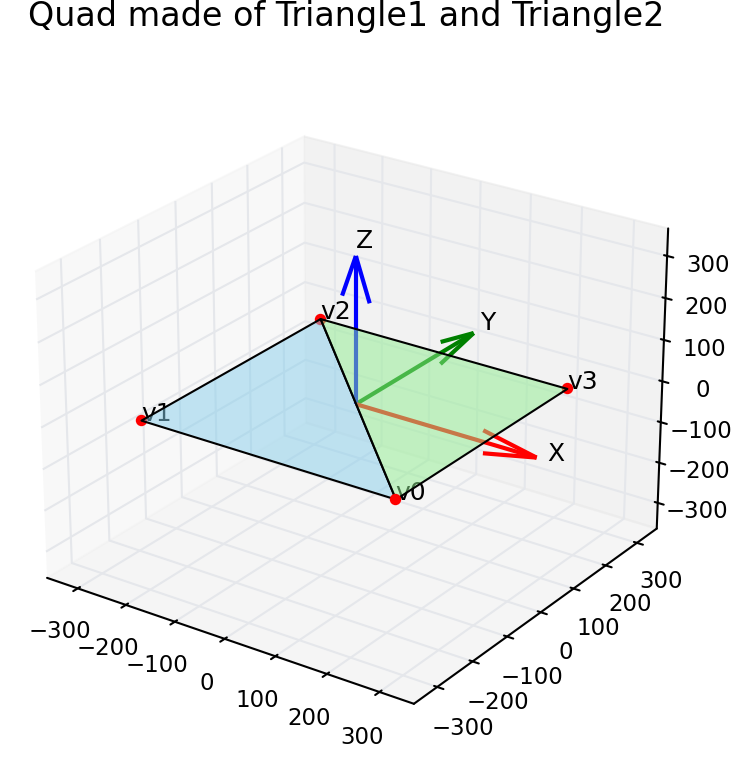

#### Vertex

A vertex is a data structure that represents a single point in a geometric shape used by the GPU during rendering. In graphics programming (Metal, OpenGL, DirectX, Vulkan), all shapes—triangles, quads, meshes—are built from multiple vertices. Each vertex carries the information the GPU needs to transform, shade, and rasterize that point.

This is the minimum definition of vertex.

@code_begin@
struct Vertex {
        // the position member represents the location of that vertex in space
        float2 position;
        
        // The texture coordinate refers to the coordinates used to map a texture image onto a vertex.
        float2 texCoord;
};
@code_end@

The texture coodinate is typically a float2 value:
* u : horizontal texture coordinate
* v : vertical texture coordinate

Both values are usually in the range 0.0 to 1.0, representing normalized positions inside the texture.

Following data is presented by vertices
* A triangle is defined by three vertices.
* A quad is defined by six vertices (two triangles).
* A 3D model may contain thousands or millions of vertices.

#### Quad Vertex

Following code defines a constant array of vertices that
represents a rectangular quad made from two triangles. 
This pattern is very common in Metal, OpenGL, and Direct3D rendering.

@code_begin@
        {
            // Pixel positions, Texture coordinates
            { {  250,  -250 },  { 1.f, 1.f } },         // triangle-1
            { { -250,  -250 },  { 0.f, 1.f } },         // triangle-1
            { { -250,   250 },  { 0.f, 0.f } },         // triangle-1

            { {  250,  -250 },  { 1.f, 1.f } },         // triangle-2
            { { -250,   250 },  { 0.f, 0.f } },         // triangle-2
            { {  250,   250 },  { 1.f, 0.f } },         // triangle-2
        };
@code_end@

